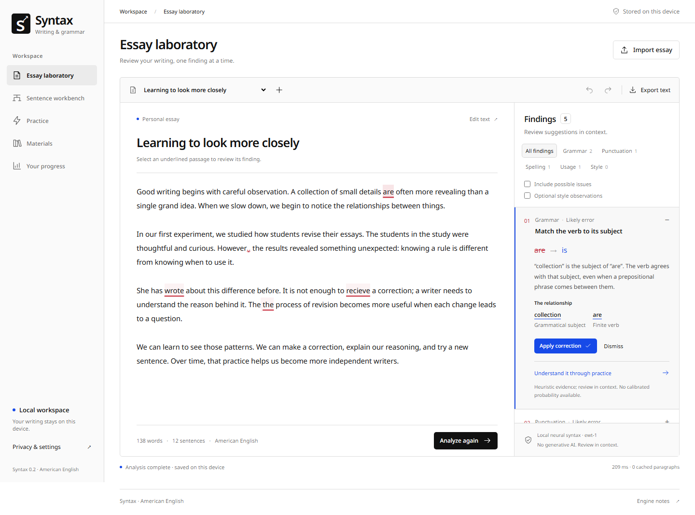

# Linguorithm

**An English grammar checker, sentence analyzer, and practice workspace that runs locally in your browser.**

Linguorithm combines an essay editor, sentence workbench, adaptive practice, and learning records in a SolidJS/TypeScript application. Compact trained models run in a browser worker. Writing stays in the browser: no accounts, essay uploads, analytics, remote fonts, or generative services.

[Quick start](#start-locally) · [Features](#what-you-can-do) · [Writing progression](docs/writing-progression.md) · [Model card](docs/model-card.md) · [Contributing](CONTRIBUTING.md) · [Support](SUPPORT.md)



## Why Linguorithm

A correction is more useful when you can inspect its reasoning. Linguorithm connects a finding to the original words, the grammatical relationship behind it, and a focused practice exercise. You control each edit, can undo it exactly, and keep your writing on your device.

For writers, tutors, and developers who want an inspectable local grammar tool, it combines compact discriminative models with explicit constraints. It proposes bounded edits rather than generating replacement paragraphs.

| Your goal                                        | Start here                                |
| ------------------------------------------------ | ----------------------------------------- |
| Try the editor and practice exercises            | [Run Linguorithm locally](#start-locally) |
| Understand accuracy, privacy, or model limits    | [Model card](docs/model-card.md)          |
| Reproduce a bug or question a grammar finding    | [Support and reporting](SUPPORT.md)       |
| Improve grammar examples, documentation, or code | [Contribution guide](CONTRIBUTING.md)     |

## Start locally

With GNU Make and Node.js 24 LTS available, clone the repository and run from its root:

```sh
make install-pnpm
make install
make dev
```

Dependency setup is explicit and project-local. If this working copy is already prepared, start directly with `make dev`. Open the address printed by Vite. For a production build:

```sh
make check
make build
make preview
```

The preview runs at [127.0.0.1:4317](http://127.0.0.1:4317). A fresh clone needs Node and explicit dependency setup; see the [quickstart](docs/quickstart.md) for Windows, macOS, and Linux. The build restores bundled, hash-verified models from the tracked release archive. Frontend builds need neither Python nor training-data downloads.

## What you can do

- **Revise an essay.** Follow diagnostics back to source spans, compare revisions, undo changes, review contextual spelling candidates, and maintain a personal dictionary.
- **Choose a writing lens.** Set an intent for the draft, use optional reflection prompts, and browse a general progression from emergent writing to advanced transferable skills.
- **Explore a sentence.** Inspect predicted parts of speech and dependency diagrams, including alternative analyses and visible model/fallback status.
- **Practice deliberately.** Work through seven skills with progressive hints, free-response repairs, and a validated bank of 106 questions.
- **Learn from your materials.** Import TXT, Markdown, inert HTML, DOCX, PPTX, XLSX, and text-based PDF while retaining source structure and question provenance.
- **Track your work.** Review pre/post/delayed/transfer assessment records, export CSV, and back up or restore local data.

Goal-map entries distinguish unvalidated rule coverage from goals without a detector. Assessment records support reflection; they do not establish a measured learning benefit. Read the [writing progression and source mapping](docs/writing-progression.md) for scope and limitations.

## How analysis works

The `ewt-1` release includes a character-CNN/BiLSTM/CRF tagger, beam dependency parser, synthetic-error classifier, and trained contextual correction ranker. The SCOWL-derived dictionary recognizes 121,191 forms. Resource hashes are checked before inference, and failures visibly activate deterministic fallback analysis.

The shipped component models measure **94.47% POS accuracy**, **81.66% UAS**, and **77.27% LAS** on 1,962 held-out UD English EWT test sentences. The current production-browser path measures **93.50% POS**, **81.91% UAS**, and **77.81% LAS** on the fixed 300-sentence, 3,659-token EWT sample across answers, email, newsgroup, reviews, and weblog; tokenization mismatches count as incorrect. The browser figures are higher than the original 92.18%/80.16%/76.09% baseline, but still miss the requested five-point improvement floor. The sample was inspected during tokenizer development, so it is a reproducible regression measure rather than untouched confirmation. Both evaluations are within-corpus evidence, not independent learner-essay validation.

No error-classifier category currently passes the release emission gate, so statistical findings remain review-only. The fixed document-held-out evaluation on 184 Russian-L1 university essays measures 15.69% token precision, 3.19% recall, 7.52% token misclassification, and 1.21% false-positive rate. The latest candidate has 17 fewer unannotated predictions with unchanged recall: pronoun-reference ambiguity is now optional style feedback, while contextual spelling abstention remains active. These results remain far from the requested thresholds. The corpus lacks author identities and does not validate individual goal detectors or correction quality. See the [REALEC evaluation](reports/realec-independent-evaluation.json), [measured browser evidence](reports/generalization.json), and [model card](docs/model-card.md#independent-learner-writing-benchmark).

Read the [model card](docs/model-card.md) for provenance, evaluation methods, domain limits, quantization results, and licensing. Initial successful model loading enables offline reuse through the service worker; browser storage eviction can require loading assets again.

## Developer commands

| Command | Purpose |
| --- | --- |
| `make dev` | Start the development server |
| `make check` | Lint, formatting check, TypeScript, and engine tests |
| `make release` | Source, content, clean model restore, build, bundle, and browser release checks |
| `make build` / `make preview` | Restore models, build, and serve production output |
| `make test` | Run engine unit tests |
| `make browser` | Run Playwright tests against the production build |
| `make evaluate` | Evaluate deterministic engine behavior |
| `make models` / `make validate-models` | Restore or verify packaged model resources |
| `make content` | Validate questions and formatter configuration consistency |
| `make bundle` | Check built bundle budgets |
| `make benchmark` | Run the engine benchmark |
| `make evaluate-parser-beam` | Select a parser beam width on the pinned EWT development split and bind the report to model hashes |
| `make ingest-realec` | Prepare a fixed learner-essay evaluation split in the project-local cache |
| `make evaluate-realec` | Run the production browser worker on that held-out split and report aggregate detection evidence |
| `make evaluate-parser-beam-test` | Score only the development-selected width on the fixed EWT test split and write the no-regression report |
| `make inspect` | Inspect the running production preview |
| `make social-preview` | Render the editable social preview to its GitHub-ready PNG |
| `make train` | Retrain, evaluate, and package local models using `.venv` |

Use `make help` for setup and additional evaluation targets. Pass options with `ARGS`, for example `make browser ARGS="--project=chromium"`. Browser tests require `make build` first. Inspection and browser benchmarks require `make preview` in a separate terminal. Normal tasks never install missing prerequisites automatically.

## Project map

| Path              | Contents                                                          |
| ----------------- | ----------------------------------------------------------------- |
| `apps/web`        | SolidJS application, worker, local persistence, production assets |
| `packages/engine` | Analysis, practice, assessment, import domain logic               |
| `content`         | Validated practice content                                        |
| `models/releases` | Versioned browser-model release and integrity manifest            |
| `training`        | Reproducible training, calibration, and packaging pipeline        |
| `tests/browser`   | Browser workflows, inference parity, failure cases                |
| `reports`         | Recorded evaluation and verification evidence                     |
| `docs`            | Model card, specification, release status, research               |

Production output is `apps/web/dist`. It uses relative asset paths for project subpaths and includes a GitHub Pages deployment workflow. Connect the repository to GitHub, set **Settings → Pages → Build and deployment → Source** to **GitHub Actions**, and push to `main`; the site deploys only after the `Verify platform` workflow succeeds. A maintainer can also start the deployment workflow manually. Keep the workflow's Pages permissions enabled and preserve all packaged resource notices. No public URL is claimed until the deployment completes successfully.

## Contributing and support

Start with [contributing](CONTRIBUTING.md), the [support guide](SUPPORT.md), and our [code of conduct](CODE_OF_CONDUCT.md). Report vulnerabilities using the [security policy](SECURITY.md). Bug, grammar feedback, and feature templates are available through this repository's Issues page.

If Linguorithm is useful to you, star the repository so others can find it. Share a reproducible workflow or a short synthetic grammar example to help other writers and educators assess whether it fits their needs. Good bug reports, carefully reviewed grammar examples, and small, tested contributions help the project improve.

Maintainers can use the [GitHub presentation guide](docs/github-discovery.md) for the prepared social preview, suggested topics, and repository settings.

See the [engineering specification](docs/engineering-specification.md), [training guide](training/README.md), [release status](docs/release-status.md), and [recorded verification](reports/verification.md) for technical context. Independent natural-learner validation, educator review, comparative trials, physical-device performance, and a consented learning study remain external release requirements.

## License and attribution

Application source is available under the [MIT License](LICENSE). Bundled models, corpora, dictionaries, and runtime dependencies retain their own licenses. UD English EWT is CC-BY-SA 4.0; the dictionary includes multiple upstream notices. Consult the [model card](docs/model-card.md), provenance manifests, and `apps/web/public/models/licenses/` before redistributing resources. Preserve those notices and applicable attribution/share-alike obligations. The source MIT license does not replace resource licenses.
